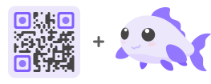
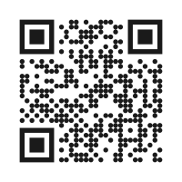
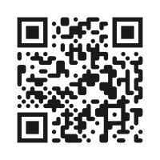
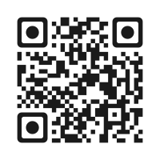
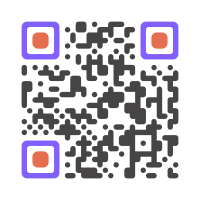

<div align="center">
	

# QR codes for Coi

[](LICENSE)
[](http://makeapullrequest.com)

Draw QR codes as SVG in [Coi](https://github.com/coi/coi), plain or styled.

</div>

This package gives you:

- `<Qr::Code />`, a whole code as an SVG, coloured from CSS
- Looks: square or round dots, soft blobs, finder eyes in their own shapes and colours, a logo in the middle
- Any text in byte mode (UTF-8), versions 1 to 40, all four error correction levels
- The same codes as the reference encoder ([Nayuki's qrcodegen](https://www.nayuki.io/page/qr-code-generator-library)), module for module
- `Qr::encode`, `Qr::draw` and `Qr::path` underneath, for paths of your own

## Install

Install from the Coi registry:

```bash
coi add @coi/qr
```

Then import it:

```coi
import "@coi/qr";
```

## Quick Start

```coi
import "@coi/qr";

component Share {
	style {
		.code { width: 240px; }
	}

	view {
		<div class="code">
			<Qr::Code text="https://example.com/join/KQ7RMX" />
		</div>
	}
}
```

The code fills the width of its parent, on a white square with the four-module quiet zone around
it. A new `text` redraws it.

## Gallery

The same link in each look, drawn by the package and checked with a scanner.

<table>
<tr>
<td width="33%" align="center">


```coi
<Qr::Code text={link} />
```

</td>
<td width="33%" align="center">


```coi
<Qr::Code
	text={link}
	look={Qr::Look{
		dots = Qr::Dots::Round,
	}}
/>
```

</td>
<td width="33%" align="center">


```coi
<Qr::Code
	text={link}
	look={Qr::Look{
		dots = Qr::Dots::Blob,
	}}
/>
```

</td>
</tr>
<tr>
<td align="center">


```coi
<Qr::Code
	text={link}
	look={Qr::Look{
		ring = Qr::Eye::Rounded,
		pupil = Qr::Eye::Round,
	}}
/>
```

</td>
<td align="center">


```coi
<Qr::Code
	text={link}
	look={Qr::Look{
		dots = Qr::Dots::Blob,
		ring = Qr::Eye::Rounded,
		pupil = Qr::Eye::Rounded,
	}}
/>
```

```css
--qr-body: #464445;
--qr-rings: #825fff;
--qr-pupils: #e76f51;
```

</td>
<td align="center">


```coi
<Qr::Code
	text={link}
	level={Qr::Level::H}
	look={Qr::Look{
		dots = Qr::Dots::Blob,
		ring = Qr::Eye::Rounded,
		pupil = Qr::Eye::Round,
		logo = 0.3,
	}}
	logo="/images/logo.svg"
/>
```

```css
--qr-body: #464445;
--qr-rings: #825fff;
--qr-pupils: #9477ff;
```

</td>
</tr>
</table>

## Component API

```coi
<Qr::Code text={link} level={Qr::Level::H} look={Qr::Look{dots = Qr::Dots::Blob}} logo="/logo.svg" />
```

### Props

- `text`: what the code holds
- `level`: `Qr::Level::M` by default (`L`, `M`, `Q`, `H`)
- `look`: `Qr::Look{}` by default, plain squares
- `logo`: an image URL, drawn in the hole `look.logo` clears

The levels repair about 7%, 15%, 25% and 30% of the code. `M` is the usual choice; take `Q` or `H`
for a logo. The smallest version that holds the text is used: 21 × 21 modules for up to 14 bytes at
`M`, 29 × 29 for a 40-byte link.

### Looks

- `dots`: `Qr::Dots::Square`, `Round` (a circle per module) or `Blob` (free corners rounded, so
  neighbours flow into each other)
- `ring`: the finder eyes' outer ring, `Qr::Eye::Square`, `Rounded` or `Round`
- `pupil`: the eyes' centre, the same three
- `logo`: how much of the side to clear in the middle, `0.3` for 30%

Every field is optional. The logo hole is made odd so it sits on the middle module, and shrunk to
what the error correction can still repair with a quarter to spare: a level `M` link has little
room, at `H` a short link leaves about a third of the side.

### Colors

- `--qr-body`: the data modules, `currentColor` when not set
- `--qr-rings`: the eyes' outer rings, the body's colour when not set
- `--qr-pupils`: the eyes' centres, the body's colour when not set
- `--qr-back`: the square behind it all, white when not set

They are CSS variables, set on the component's parent or anywhere above it. The SVG has
`role="img"` and the text as its `aria-label`.

## Functions

- `Qr::encode(text, level)` gives a `Qr::Matrix`
- `Qr::draw(matrix, look)` gives a `Qr::Drawing`
- `Qr::path(matrix)` gives the whole code as one path of squares

`Qr::Matrix` has `n` (modules per side, 0 when the text doesn't fit version 40), `dark` (`n * n`
bools, row by row, no quiet zone) and `room` (the widest square in the middle that may be left out).

`Qr::Drawing` has the paths `body`, `rings` and `pupils`, the side `n`, and `hole`, the side of the
cleared square, which starts at `(n - hole) / 2` on both axes.

Paths use one unit per module with the origin at the code's top left corner.

## Examples

### 1) A styled code with a logo

```coi
component Join(string link) {
	style {
		.code {
			width: 320px;
			--qr-body: #464445;
			--qr-rings: #825fff;
			--qr-pupils: #9477ff;
		}
	}

	view {
		<div class="code">
			<Qr::Code
				text={link}
				level={Qr::Level::H}
				look={Qr::Look{dots = Qr::Dots::Blob, ring = Qr::Eye::Rounded, pupil = Qr::Eye::Round, logo = 0.3}}
				logo="/images/logo.svg"
			/>
		</div>
	}
}
```

### 2) Round dots for a dark page

```coi
<div class="code">
	<Qr::Code text={link} look={Qr::Look{dots = Qr::Dots::Round, ring = Qr::Eye::Round, pupil = Qr::Eye::Round}} />
</div>
```

```css
.code { --qr-body: #1a1a1a; --qr-back: #f5f3ff; }
```

Keep the dark parts darker than the background: scanners read a light code on a dark square badly.

### 3) Paths of your own

```coi
component Plain(string link) {
	mut Qr::Matrix m = Qr::encode(link, Qr::Level::M);

	view {
		<svg viewBox="-4 -4 ${m.n + 8} ${m.n + 8}">
			<path d={Qr::path(m)} />
		</svg>
	}
}
```

The `viewBox` adds the four-module quiet zone, which has to stay light.

## Limits

- Byte mode only: digits and capitals take the same room as any other text.
- Not every scanner finds round eyes. ZXing reads every look; OpenCV's detector finds `Square`
  rings always, `Rounded` ones most of the time and `Round` ones never.
- The `logo` image isn't checked: anything drawn outside the hole can still break the code.

## Development

```bash
coi test
```

The tests compare codes with the reference encoder, module for module, and check the paths and the
component.

## License

MIT License (see [LICENSE](LICENSE)).
